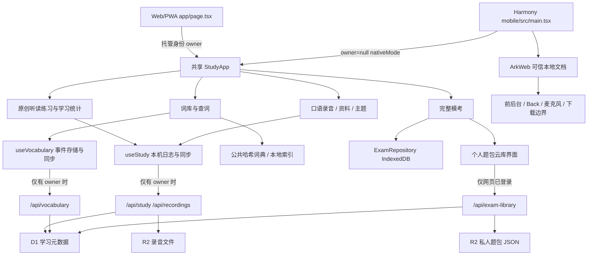

# 微光托业架构现状

审查日期：2026-10-13。本文描述实际源码，不是重构完成报告。代码基线为 Sites checkout `main` / `12317b26b85a71888760b0cc18242d00a843ac74`，树 `8653fe5f8ff54651d038105ba67d1ba39bab9cc8`。评审开始时工作区干净；正式索引、证据与验证边界见 [README](README.md)。

## 1. 运行入口与责任

| 层/模块 | 当前职责和依赖 | 代码依据 |
|---|---|---|
| Web入口与运行时 | `Home` 取得服务端 owner；Vinext/Vite 经 Worker app-router 运行，D1 `DB` / R2 `BUCKET` 绑定来自既有托管配置 | `app/page.tsx:1–4`；`worker/index.ts:36–52`；`vite.config.ts:1–78`；`db/index.ts:getDb` |
| 共享产品壳 | 导航、设置/打卡/安装/主题弹窗、训练队列、进度统计和功能入口。直接引用内容、学习hook、纯模型及素材目录 | `app/study-app.tsx:12–28,35–64,71–110`，`StudyApp` |
| 纯学习模型 | `StudyData` v2、合并/迁移、首答统计、间隔复习、选题与今日建议；无 React/数据库依赖 | `lib/study-model.ts:16–24,53–71,77–126` |
| 学习状态与同步 | 按 owner/device 分区快照、操作日志/ack、重试/只读门禁；录音Blob存储及远端上传；输出保存接口 | `lib/use-study.ts:7–30,31–193`，`useStudy` |
| 原创听读/口语 | 小组练习即时反馈、解析/听写；口语准备/作答/录音/自评。系统朗读或已打包音频，不是AI正式评分 | `app/learn/practice.tsx:SpeechPlayer,Practice`；`app/learn/speaking.tsx:SpeakingRoom`；`lib/lesson-audio.ts` |
| 词卡领域 | 收藏、自测事件、独立复习等级与备份；`useVocabulary`有自己的账号、同步及错误状态 | `lib/vocabulary-model.ts`；`lib/use-vocabulary.ts:5–30` |
| 查词领域 | 整文件懒加载、SHA/数量/结构校验；合并场景词与一般释义，建立全文字符串索引、精确/前缀优先搜索 | `lib/load-dictionary.ts:5–22`；`lib/dictionary-model.ts:parseDictionary,mergeWordCatalog,indexDictionary,findDictionary` |
| 完整模考领域 | 严格题包校验、时间状态机、答案与成绩模型；owner作用域 IndexedDB 事务、revision冲突、导入/恢复/移除保护 | `lib/exam-model.ts:parseExamPackage,advanceAttempt,gradeAttempt,validateAttempt`；`lib/exam-storage.ts:ExamRepository,openExamRepository` |
| 模考界面/媒体 | 开考门禁、预检、原截止计时、答案保存、交卷、图片放大、活动中断、导入与云库、完整备份 | `app/learn/mock-exam.tsx:39–315,ExamAudio`；`lib/exam-ui.ts:createExamOwner,createExamTaskQueue,checkExamAudioDuration` |
| 个人题包云库 | 元数据 D1 + 文件 R2；容量预约、流式上传、哈希确认、按需下载及取消。不是模考记录云存储 | `app/api/exam-library/route.ts:GET,POST,DELETE`；`lib/exam-library.ts:prepareLibraryFile,checkedLibraryDownload`；`app/learn/exam-library.tsx:29–60` |
| 原生宿主 | ArkTS/ArkWeb加载可信本地资源、外链送系统浏览器、音频权限、前后台与Back协议、有限下载导出 | `harmony/entry/src/main/ets/pages/Index.ets:isTrustedDocument,intercept,requestMicrophone,handleNavigation,onBackPress`；`NativeDownloads.ets`；`lib/native-host.ts` |

这是一套共享 React 产品、几个独立数据领域及两个运行宿主。`mobile/`只作为鸿蒙网页打包入口，复用根目录依赖，没有Android/iOS/Capacitor活动工程。`mobile/src/main.tsx:8–11`装入音频和原生协议后，以 `owner={null}`启动相同 `StudyApp`。

## 2. 数据分区、持久化与备份

| 对象 | 本机存储 | Web云端 | 原生 HAP | 备份/恢复与版本 |
|---|---|---|---|---|
| 一般学习 | `lantern-v1-<owner或device>`；快照、独立op/ack、profile/recording及同步问题键 | `/api/study` → D1；题目正确性由服务器重新计算 | 本机写入，owner=null不调用私有API | StudyData schemaVersion=2；`createStudyBackup`导出JSON；`restoreBackup`已有hook但没有主界面恢复入口 |
| 口语音频 | `lantern-audio` IndexedDB v1，键包含owner分区与recording ID | `/api/recordings` → R2字节+D1元数据 | 真实录音仍由共享MediaRecorder经ArkWeb权限使用，本机Blob | 学习JSON明示 `audioIncluded:false`；恢复元数据清除uploaded信任，不会凭空恢复音频 |
| 词卡记录 | `vocabularyKey(owner)`下不可变事件，本机事件读取/合并 | `/api/vocabulary` → `vocabulary_events` | 本机保存 | `lantern-vocabulary` v1，独立导入/导出UI |
| 模考 | `lantern-private-exams-v1` IndexedDB **版本3**，packages/catalog/attempts按owner复合键 | **没有考试记录同步API/表** | 本机导入、作答、恢复、导出 | `lantern-exam-backup` schemaVersion=1，包含题包媒体与考试历史；事务合并并拒绝冲突，不倒退活动考试 |
| 私人云题包 | 下载校验后导入上行本机模考库 | `exam_library` + R2 JSON；上限32份/2 GiB，单份96 MiB | 系统浏览器登录下载JSON，再由App导入；无内嵌云身份 | 这是内容分发/取回，**不包含作答历史**；本机总容量192 MiB，已有考试记录的包禁止移除 |
| 字典与教材 | 内容JSON、公共哈希词典；鸿蒙附带1,015段匹配文本音频 | 公共静态数据，无用户查词远端接口 | 随包可用；通用词典未覆盖全库发音 | 内容、素材、词典分别有来源和许可；搜索没有自动创建练习事件 |

依据：`lib/use-study.ts:32,40,56–120,168–193`；`lib/study-backup.ts:16–33`；`lib/use-vocabulary.ts:5–29`；`lib/exam-storage.ts:14,40,181–243`；`lib/exam-model.ts:EXAM_LIMITS`；`docs/EXAM_LIBRARY.md:3–13`。不要把“导出完整模考备份”与“导出学习JSON”混称为覆盖所有用户数据的完整备份。

## 3. 主要数据流与规则

1. **原创练习**：`Practice`接受共享题组 → 用户提交 → `useStudy.addAttempt`先本机持久化 → 不可变op → Web服务器校验题目/选项并重算correct → ack → 拉取/合并远端。`firstAttempts`按createdAt取每题首答，复练保留；复习成功间隔1/3/7/14/30天，提前重复不升级，错误重置（`study-model.ts:78,95–118`）。这是练习正确率，不换算正式TOEIC成绩。
2. **词库/查词**：240旧场景词+567新增场景词+55题内表达构成862学习条目；84,979通用词典提供一般释义。打开 `VocabularyLibrary` 即启动全字典加载；`mergeWordCatalog`保留既有学习ID和场景义；查询经索引过滤排序，界面先显示24项，但计算候选是全部匹配。收藏或自测才产生 `VocabularyEvent`，不进入 `StudyData.attempts`（`vocabulary-library.tsx:18–35,45–57`；`dictionary-model.ts:20–54`）。
3. **模考**：本地JSON/云文件 → 限制字节、模型及媒体验证 → fingerprint → IndexedDB原子保存 → 图片解码+音轨时长预检+本人试听确认 → 开考保存固定截止时间 → serialized task queue/revision写答案 → 原截止自动推进/交卷 → 本地分Part结果。后台/退出/音频故障会记录中断并影响有效性，计时继续；恢复不得重设截止（`mock-exam.tsx:123–230,393–544`；`exam-model.ts:258–343`）。2006旧题型需明确format，不能猜测或与现行基线混合。
4. **口语**：权限→MediaRecorder→停止/Blob→本机音频成功后才保存元数据→Web上传→回听优先云确认或本机Blob。前后台/退出保护有generation和高优先Back处理（`speaking.tsx:12–33`；`use-study.ts:90–112,181–192`）。发现的录音幂等问题见问题 F01；已有退出保护不等于云落盘一致性已充分覆盖。
5. **资料与计划**：ResourceTask模型/API/hook已有；实际资料打卡入口仍将资源ID编码进checkin.note，`ResourceLibrary`和`ExamCollection`用子串计数。今日建议由 `dailyPlan`即时推导，非持久化完整学习计划（`resource-library.tsx:18`；`exam-collection.tsx:19`；`study-app.tsx:36,57,108`）。

## 4. 身份、网络与原生边界

`lib/server-auth.ts:2`信任托管层注入的 `oai-authenticated-user-id`。写API再核对客户端期望owner、来源及输入；`privateJson`设置private/no-store。可信头清洗属于部署网关责任，直接暴露该Worker或自行复制客户端头不能获得同等身份保证；此评审未验证网关实现，也未发现跨用户读取泄露。

`safeMutation`允许无Origin或同源（`server-auth.ts:3`）；测试替身与真实函数存在策略差异，详见 F09。手机号真实认证、短信及原生令牌校验没有上线；readiness脚本不等于认证实现。`app/chatgpt-auth.ts`为另一个邮件/显示名辅助接口，当前主页面和API实际使用 `server-auth.userId`。

原生可信文档是 `https://lantern.local` 的包内资源。宿主严格解析本地路径、拦截外部导航，并在可信/前台状态下处理麦克风与Back；JS侧只注册前后台和Back有限协议，不暴露任意文件/网络/身份操作（`Index.ets:10–60,112–123,250–267,280–359,399–449`；`native-host.ts:29–59`）。原生下载由专门模块处理，并不使网页拥有任意文件系统访问权。

Web Service Worker不缓存私有HTML/API，冷启离线回到说明页；已打开应用可本机记队列；词典公共哈希文件可以缓存。不能把网页描述为已实现原生级完全离线冷启动（`public/sw.js:1–9`）。

## 5. 主题与UI系统

现四个持久ID为 `hollow/silk/paper/crystal`，都绑定IP相关目录。CSS同时有早期语义token、html级主题映射、`.atlas-app`局部映射和后追加控件样式。栏目场景来自 `mapScenes.views[nav]`，与profile.theme配色分离；导航、任务及休憩缩略图也独立。已有html基础映射使模考/Portal能取到部分主题，问题是完整语义契约和覆盖范围漂移，不能称为全部“无主题”。

模考在壳内提前返回 `.mock-shell`，通用Dialog进入body Portal；重设计必须用根级完整token和各主题素材策略覆盖它们。无IP日/夜是用户本轮目标，**现代码未实现**。theme-only保存已保护其他profile设置，旧完整profile操作仍为兼容保留（`study-app.tsx:53,61,64,71,74–84,110`；`globals.css:35–43,109,305–313`；`use-study.ts:73–82,114–120,145–152`；`api/study/route.ts:22–26`）。详见 [UI约束](UI_ALIGNMENT.md)。

## 6. 构建、测试与发布边界

根锁文件与Node >=22.13是共用依赖基线；Web `build-verified.mjs`负责有界构建/产物验证；mobile构建先校验音频，再Vite打包；harmony `sync:web/check:web`复制并核对包内资源。SDK/HAP/签名与真机升级是后续独立层级。

Core工作流包含内容、模型、类型、构建契约、真实Poppler合成PDF、真实Chromium模考/查词及nativeMode/Web主题fixture、SQLite迁移。Harmony常规CI只检查工具/共享资源，明确不编译SDK；source-release工作流另有SDK构建。运行测试、保存版本、部署Sites、GitHub Release、HAP签名/安装/验收不是同一结果（`.github/workflows/core.yml:25–82`；`harmony-web.yml:27–39`；`source-release.yml:93–97`）。本轮未构建或发布。

## 7. 实现/计划/历史文档分类

| 状态 | 能力或文档 | 本轮结论 |
|---|---|---|
| 已实现且本轮读到代码 | 学习事件同步、词卡同步、模考/本地完整备份恢复、云题包、旧题型判分、theme-only原子保存 | 代码现状；测试或历史真机验收的范围另列，不扩大 |
| 接口已有，页面未接入 | QuestionMark/ResourceTask编辑、学习JSON restoreBackup | `StudyApp:36`未消费这些hook接口；既有“UI后续”仍有效 |
| 目标/后续 | 原生认证/学习同步、模考记录云同步、手机号、无IP日/夜主题、持久完整计划、新增词助记/例句跟读、AI自动评分 | 无相应现行交付证据，不写成已完成 |
| 部分过时 | `docs/ARCHITECTURE.md:31`“全题组模考后续计划” | 已由现模考实现替代；其他关于学习JSON不含音频、标记/恢复UI待办仍正确 |
| 历史快照 | 根目录2026-09-13接续摘要、README历史v0.3.2构建段、PROJECT_STATUS早期设备与版本段 | 按日期保留，不作为当前状态入口；最新专门说明/代码优先 |

评审指出的风险及证据见 [FINDINGS](FINDINGS.md)，建议边界见 [TARGET_AND_PLAN](TARGET_AND_PLAN.md)。
