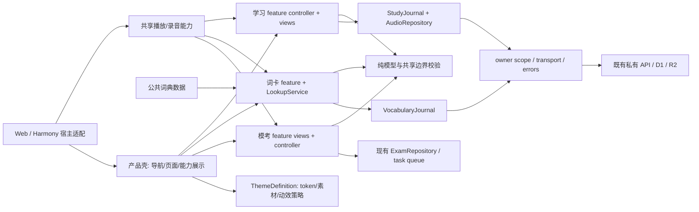

# 目标边界与渐进整理计划

这是待执行建议。当前授权仅梳理、评审和归档，本轮没有重构代码、迁移用户数据、发布、推送或合并。

## 目标边界

保持共享React和领域纯模型；先把“谁拥有数据/副作用/保存成功门禁”写清，再渐进抽取。目录名称可在后续实施时决定，以下接口表示责任，不是已创建的新模块。

| 责任 | 应允许的依赖 | 应避免的依赖 |
|---|---|---|
| 纯模型/校验 | TS值对象、无副作用解析与合并 | React、DOM、localStorage、Worker env、UI功能组件 |
| Repository/journal | 纯模型、明确owner范围、存储adapter | 页面toast/导航/主题图片；未定义的跨领域事务 |
| feature controller | repository、生命周期、纯派生、可注入transport | 隐式模块全局账号、UI内直接数据库写入、绕过持久化成功门禁 |
| 纯view | props/回调、通用控件与token | fetch/存储重试/录音授权/考试截止重算 |
| LookupService | 稳定wordId与来源、加载状态、查询/排序合同 | 自动生成听读作答或推高学习计划 |
| ThemeDefinition | 根级语义token、素材policy、可访问性/动效policy | 完整profile覆写、学习ID或题包fingerprint更改 |
| 宿主适配 | 明确媒体/下载/Back/前后台能力 | 任意JS-native文件/网络桥，云身份凭据打包进HAP |

StudyData、VocabularyEvent与ExamAttempt保留独立领域与版本；私人云题包保持文件分发边界。可共享校验、owner作用域与transport错误分类，不能强行合并store/复习规则，也不因文件抽取更换状态库或ORM。`ExamRepository`事务、`ExamUiSession`串行队列是已有良好边界，应先保留。

## 分阶段计划

| 阶段 | 小范围交付 | 依赖/验收出口 | 回滚界限 |
|---|---|---|---|
| S0 现状冻结（本轮完成） | 本目录现状、证据问题、三项独立意见、UI合同、验证矩阵与索引 | 原生产tracked文件逐字节保持；具体评审分歧可追溯；明确未实现能力 | 仅撤回/修正文档，无应用版本改变 |
| S1 可靠性修正（建议下个小版本） | 分开处理录音ID/字节幂等、音频abort终态、坏主快照隔离；收敛日期/Profile/Theme输入合同 | F01–F05合成先失败后通过；D1/R2失败/重试；坏字节保持；旧备份能恢复；存储/身份改动补相关集成 | 优先无schema/key变更；需要owner+ID索引迁移时单独提案，先备份与完整fixture；不得自动重写历史事件 |
| S2 可审查的视图抽取 | StudyApp按今日/练习/复习/进度/资料及壳弹层抽纯view；SpeechPlayer独立；模考先仅抽目录/预检/题面/结果 | 回调与保存顺序不变；首答/复练/题组、录音退出、模考Back/截止、弹窗与窄屏回归；每次只一条责任链 | 不改schema/owner/key/ID/题包字节；可直接恢复旧view，保留新数据接口兼容 |
| S3 与已审UI方案对齐 | 完整四主题根token和素材policy；兼容旧Theme；搜索入口/结果/详情布局、全状态显示 | 无IP日/夜全页面无角色素材；IP两套一致；theme-only保护目标；根Portal/模考、focus、reduced motion；搜索源/发音能力准确 | 旧Theme值仍可读；如引入新值，服务端/备份/队列须先兼容，禁止旧代码读取新枚举后写回默认 |
| S4 查询与同步可维护性 | LookupService及测量后选索引/Worker；小型共享transport/能力提示；测试助手去重复 | 排序、中文/副义/词形搜索、旧ID/收藏不变；加载失败核心词可用；账号切换/abort/重试保留；目标设备性能记录 | 可切回旧查询adapter；保留数据来源/hash/许可，不迁移用户事件；词库同步常驻是否改变单独评审 |
| S5 新结构化功能与存储演进 | 明确RFC后接错因/任务编辑/学习恢复UI；legacy note adapter；若需要才规划音频完整备份、原生认证/考试云同步 | 新能力独立需求/信任/隐私边界；note原文保留，checkin实际分钟不双计；版本/迁移账本/中断恢复及数据比较 | 任何存储或身份迁移先有正式备份/兼容/停止方案，逐用户或隔离环境验收；不得顺带清用户旧数据 |

不按文件大小设拆分目标，也不承诺未测工期。S1与UI隔离方案可并行；S2/S3生产实现只在所改责任的合同/门禁明确后推进。S4优化依据实测，不预先引入Worker或全局state管理库。S5属于后续产品范围，不在此次或纯UI改版中暗中扩张。

## 每个后续整理PR应交付

1. 一个明确行为/责任变化，写清前后例子和触发条件；列出不变量和涉及的owner/storage/API/backup合同。
2. 对应缺陷或抽取的行为回归；先失败/后通过证据，或纯视图真实渲染/交互比较。保留原测试，不用新实现镜像断言代替行为。
3. 数据/资源/媒体生命周期比较；声明是否改变schema、字节、版本、截止或owner。若无变化用哈希与合成fixture确认。
4. 本机、CI、托管服务、共享构建、SDK、签名、真机结果分别列明；未跑的门禁与剩余限制不合并进总测试数。
5. 可以实际执行的回滚包/adapter/数据兼容方案和停止条件；对需要迁移的内容先单独评审，不以“重装旧版”笼统回滚。

具体回归和迁移字段标准见 [VALIDATION_AND_ROLLBACK](VALIDATION_AND_ROLLBACK.md)。
