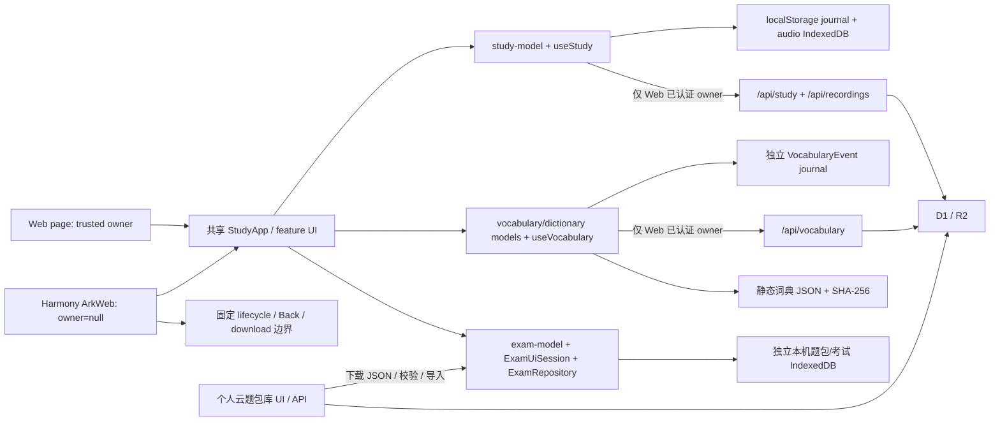

# 独立架构评审：微光托业当前实现

- 评审日期：2026-10-13。
- 评审人：`architecture_review`；另委派 `native_theme_boundary` 对原生/主题边界做只读交叉核对。
- 基线：`D:\zzl\托业学习\vocab-work\theme-redesign-20261012\site`，分支 `main`，HEAD `12317b26b85a71888760b0cc18242d00a843ac74`。这是 Sites 独立历史，不等同 GitHub main；不以旧 `lantern-site` 为现状依据。
- 基线核验：`git -c safe.directory=… branch --show-current`、`rev-parse HEAD`、`status --short`；工作区无未提交变更。safe.directory 仅传入本次命令，未修改 Git 配置。
- 范围：实际源码、README、AGENTS、TEAM、PROJECT_STATUS、CODEX_HANDOFF、架构/RFC 与相关测试源码。只读生产代码；只新建本报告，未改源码、Git、远端、用户数据、HAP、部署。
- 本文是独立审查意见，尚需由集成负责人和其他独立审查交叉回应；不声称全部建议已获共识或已实施。

## 总体判断

共享 React + 纯模型 + 平台适配的主方向正确，完整模考已具有比旧学习模块更清晰的领域/事务/界面会话分层。当前主要债务不是文件长度，而是旧 UI 聚合点、新增独立领域和历史兼容机制的契约没有统一描述：全页面主题仍只是配色叠加，资料任务仍藏在手记字符串，Profile 校验已有可复核漂移，三套持久化/同步/备份需要各自明确能力。建议先修契约与文档，再做可回滚的小规模抽取；不启动大规模重构。

## 按当前实现划分的模块与数据流

| 边界 | 当前职责与依赖 | 保存/平台范围 | 证据 |
|---|---|---|---|
| Web 入口 | `app/page.tsx` 取可信托管身份，将 owner 传给 `StudyApp` | Vinext/Worker；身份来自受信托管头，不由 UI 创建 | `app/page.tsx:1-4`；`lib/server-auth.ts:1-4`；`worker/index.ts:28-43` |
| Harmony 入口 | `mobile/src/main.tsx` 复用同一 `StudyApp` 与 CSS，安装固定原生宿主协议和打包音频 | React 静态页由 ArkWeb 加载；owner=null，nativeMode=true | `mobile/src/main.tsx:3-10`；`mobile/vite.config.ts:5`；`AGENTS.md:7` |
| 日常学习领域 | `study-model` 的首答、复练、复习调度、题组展开、预算与 Part 选择；`Practice` 产出 Attempt；`SpeakingRoom` 产出录音元数据/Blob | `useStudy` 在用户/设备 localStorage journal 保存事件与快照，音频在 IndexedDB；Web owner 可同步 D1/R2，原生仅本机 | `lib/study-model.ts:13-24,78-124`；`lib/use-study.ts:6-9,31-40,143-193`；`app/learn/practice.tsx:32-41`；`app/learn/speaking.tsx:10-38` |
| 场景词/查词领域 | authored 场景词 + 题内词 + 扩词；通用词典整文件校验、合并、索引；收藏/词卡自评独立 VocabularyEvent | 独立 localStorage journal、`/api/vocabulary`、D1 `vocabulary_events`；独立备份；不计入听读正确率/实际分钟 | `app/learn/vocabulary-library.tsx:18-35,45-56,75`；`lib/dictionary-model.ts:21-52`；`lib/vocabulary-model.ts:5-6,30-48`；`lib/use-vocabulary.ts:12-29` |
| 完整模考领域 | 200题题包严格解析、现行/2006旧题型、声明听力时长、固定阶段截止、评分与中断；Repo 原子事务/版本门禁；UI 会话 FIFO | 独立 IndexedDB `lantern-private-exams-v1` version 3；owner 分区；不写旧 Attempt/D1学习记录；完整题包+历史单独备份 | `lib/exam-model.ts:2-64,146-229,258-386`；`lib/exam-storage.ts:54-118,167-243`；`lib/exam-ui.ts:8-26`；`app/learn/mock-exam.tsx:25-30,149-158,204-264` |
| 云端题包库 | 用户明确上传完整 JSON；D1 目录状态 + R2字节与 SHA-256；下载后再次校验并导入本机 Repo | 云端只有题包文件与目录；考试记录仍本机。原生到系统浏览器登录下载，再回 App 导入 | `app/api/exam-library/route.ts:16-79`；`lib/exam-library.ts:22-50`；`app/learn/exam-library.tsx:41-57` |
| 外链资料 | 原站访问、学习步骤、学后打卡；当前关联编码进 checkin.note | 不采集/缓存外站材料为私人题库；不等于完整模考题包 | `app/learn/resource-library.tsx:18-29`；`app/learn/exam-collection.tsx:16-30`；`app/study-app.tsx:102,108` |
| 主题/场景 UI | Profile 的 Theme ID 改配色；固定栏目 mapScenes、导航/任务图独立；Radix UI 基础控件和手写产品 CSS | document 根、atlas 壳、body Portal、提前返回的模考壳均要有 token 覆盖 | `app/study-app.tsx:53,61,64,71,74-85,110`；`components/ui/dialog.tsx:22-25,59-80`；`app/globals.css:35-43,305-313` |
| 原生边界 | 固定前后台/Back 协议，HTTPS 外链转系统浏览器、受限 JSON/audio 下载、麦克风权限 | 没有给 JS 暴露任意文件/网络/身份 API；本机 owner 不能伪装云账号 | `lib/native-host.ts:23-60`；具体 ArkTS 文件见交叉核对附录 |

图中云题包库到 EXAM 是文件导入，不是考试记录云同步；Web/PWA 的旧学习同步、词库同步与本机模考历史是三条不同通路。

## 重点问题与渐进边界

优先级含义：P1 应在相关 UI/能力扩展前先定契约或补修；P2 纳入后续小迭代。以下不声称存在 P0 故障，也不把未测性能当成已发生卡顿。

### A1 · P2：Profile 校验复制已发生日期契约漂移

- 证据：`app/api/study/route.ts:14` 对 examDate 使用正则 + `Date.parse` 非 NaN；`lib/study-backup.ts:6` 使用 `validStudyDate`，后者 `lib/study-model.ts:26-28` 以年月日 round-trip 校验。Theme enum 也在模型/API/备份三处分别维护。
- 可复核行为：只读 Node 诊断对 `2026-02-31` 得到 serverDateCheck=true，解析为 `2026-03-03`，backupDateCheck=false。API 能接受但恢复验证会拒绝。正常 HTML date 控件未被证明会生成这种输入，问题在边界契约不一致。
- 影响：迁移或新主题/档案界面继续复制校验容易产生“可保存但不可恢复”的档案，主题 ID 改名也会破坏旧队列/备份。
- 建议：抽取不依赖 React/Worker 的 Profile/Theme contract，供 API、backup、UI 使用；保留已发布 ID，先补与现有数据兼容的验收再收敛调用。此阶段不改 schema，不清理历史数据。
- 分级回应：本审查初提 P1。集成负责人结合独立数据审查 actual API+SQLite 的 200/备份拒绝复现，建议采用 P2，理由是正常 HTML date 用户路径触发仍未证实；本审查接受，将其列入近期可靠性整改批次。若正常UI或真实有效备份路径稳定触发，则升 P1。API+SQLite复现由数据审查负责，本审查仅执行上述只读表达式诊断。

### A2 · P1：四套完整主题需求与当前 palette/scene 契约不一致

- 证据：`app/study-app.tsx:53,61,110` 改 Profile 配色；`:64,74,75,84,95` 从 mapScenes 取固定栏目、导航、休憩、任务图。`art/themes.json:6,75,144,213` 四项均为 IP 场景/素材，paper 并未使固定角色场景消失。
- 影响：仅修改四套 paletteName/token 无法兑现“无 IP 日间/夜间”的全页面语义；栏目图、导航缩略图、空状态和素材库仍可能透出角色。
- 建议：先制定 `themeId -> semantic tokens + scene policy + asset policy` 的完整契约，区分配色与场景语义；决定旧 Theme 值映射或显式迁移，保留旧值读取与 pending theme op 兼容。设计中需覆盖所有页面、模考、词典、图表、表单、Portal、加载/错误/禁用态。
- 限制：本评审不替设计师决定视觉风格，也不变更现有图片。

### A3 · P1：结构化资料任务基础尚未接入 UI，现存业务关联依赖手记字符串

- 证据：`lib/study-model.ts:20-22` 已有 QuestionMark/ResourceTask；`lib/use-study.ts:154-183,193` 暴露保存与恢复；`app/api/study/route.ts:40-48` 已接服务端；但 `StudyApp:36` 未消费三个保存/恢复方法，`app` 下没有 UI 调用。实际 `StudyApp:108` 写 `[资源:${id}]` 到 note，`resource-library:18` / `exam-collection:19` 以 includes 反查学习次数。
- 影响：资料关联与可编辑文案耦合；新 UI 若直接接入 ResourceTask 而仍根据字符串累计，会出现两种解释同一学习记录的机制。错因标签/任务/恢复界面不能被宣称已实现。
- 建议：建立 legacy resource-note adapter + 显式读取策略；先展示真实现状，再单独实现新任务完成流程。checkins 为实际分钟唯一来源，task.minutes 仅预算；通过稳定 checkinId 关联，保留历史 note 原文且不凭旧 note 自动生成新打卡。
- 历史决策依据：`docs/rfcs/0003-study-data-v2.md:23,29` 已明确不自动生成任务、恢复先提供代码接口。这是计划未落 UI，不是丢失数据的实证。

### A4 · P1：StudyApp 承担跨功能编排，UI 重设计容易同时触及学习不变量

- 证据：`app/study-app.tsx:39-52` 同处维护主导航、多个互斥/叠加弹层、原生 Back；`:40,55-70` 同处计算首答/复习/每日任务/复盘；`:53-54` 操作 document主题/SW/安装事件；`:95-110` 内联五个页面与打卡、目标和主题表单。判断基于责任数量与依赖，而非 115 行这一表面大小（许多行为压在单行）。
- 影响：改导航或全页面排版时，保存成功才前进、题组不拆分、首答统计、取消录音/模考 Back 等语义容易被一并修改；产品视图难以独立审查。
- 建议：按页提取 Today/Train/Review/Progress/Library 的纯呈现组件；学习派生值提取 selector；App 壳保留统一 feature navigation 与 dialog orchestration。第一批只传同样的数据/回调，不改存储 key、统计规则、状态生命周期。之后再审查是否需要专门 feature controller。
- 正向边界：`Practice` 回调产出 Attempt，`SpeakingRoom` 回调产出 metadata+Blob，完整模考已有自己的 Repo/会话；继续沿这些现有边界抽取，不把所有事件塞成一种泛化 Store。

### A5 · P2：查词加载、目录构造、查询与呈现直接耦合，需先做设备预算

- 证据：`VocabularyLibrary:32` 在进入词库时加载整个词典，即使仍处 learn 模式；`:33-35` 合并并构建 Map/全文索引；`:45-48` 每次 deferredQuery 对全索引 filter/sort；`dictionary-model:38-45` 返回全部结果，`:72-73` 仅呈现层裁成 24 个。`load-dictionary:11-18` 完整读取 ArrayBuffer、SHA、TextDecoder、JSON.parse、校验。实际词典 `dictionary-metadata.json:3526-3528,3553` 为 84,979 条、15,636,030 字节。
- 影响：首次进入、宽泛单字查询的工作量和瞬态内存都在 UI 线程路径；`useDeferredValue` 不会把算法移动到另一个线程。只能据此确认工作量，尚未证实设备卡顿或 OOM。
- 建议：抽出 `DictionaryCatalog/LookupService` 的查询接口，保留现有排序/ID/署名语义；先记录目标 Harmony/Web 的首次加载、宽泛中文/英文查询和输入延迟/内存，再决定 Worker、索引、分页或 query gating。此阶段不更换第三方词典来源或批量重写 wordId。
- 已有证据范围：`tests/dictionary.test.cjs:147-152` 仅五个完整词查询 machine timing diagnostic，明确不是 device acceptance；`dictionary-ui.test.cjs:21` 将 useDeferredValue 简化为 identity，不能验证真实输入调度。

### A6 · P2：三套同步生命周期/状态分离是有意设计，缺少共同的能力描述

- 证据：`useStudy:35-132` 有 ack、retry-state、预算与 owner generation；`useVocabulary:12-26` 则 GET全量、按25条 POST、60秒轮询且仅组件挂载时运行。词库仅在 `StudyApp:98` 的 vocabulary 导航挂载。模考始终本机 Repo。壳同步按钮 `StudyApp:69,81` 只看 useStudy，词库状态 `VocabularyLibrary:59` 单独显示；各有备份 `StudyApp:102`、`VocabularyLibrary:75`、`MockExam:254-264`。
- 影响：未来统一 UI 若直接显示一个“全部已同步”或“完整备份”会误导；词库离开页面时中止该轮请求的行为也需在全局功能定位中说明。
- 建议：保留独立 journal/合并语义，仅共享 owner scope、transport/error classification 和 capability/status presentation contract；明确 study/vocabulary/exam/audio 各自 local/cloud/backup 能力。是否让词库同步常驻壳层应单独决定与测试，不以全局 Store 抹平领域差异。
- 分歧提醒：两套复习规则类似但不相同（答题失败一天 vs 词卡忘记10分钟），不得仅因重复间隔数组而强行合并。

### A7 · P2：共享发音组件放在 Practice 功能内，形成横向功能依赖

- 证据：`VocabularyLibrary:17`、`SpeakingRoom:8` 从 `./practice` 导入 SpeechPlayer；`Practice:12-30` 是设备 TTS/内置音频/语速/控件，`lib/lesson-audio.ts:5-16` 按 Native 入口注册打包音频，`:18-61` 管全局单一播放。三者共享的实质是媒体能力，而非答题领域。
- 影响：重设计练习页或修改 practice 的导入/控制逻辑会影响词典与口语；共享控件与业务组件目录语义不清楚。
- 建议：原样抽取到共享 media component/controller，调用同一 bundled playback/TTS adapter；保留文字精确匹配、合成语音标注、全局单播放、后台暂停。不要把通用词条未打包发音补成“已离线可听”。

### A8 · P2：模考界面同时承担 controller/media/import/presentation，后续仅做谨慎抽取

- 证据：`MockExamOwner:73-96` 自维护 FIFO外 userLock/pending/UI状态；`:114-147` 构建资产 URL、图片解码、1秒 reconciliation；`:160-264` 操作中断/退出/作答/导入/恢复/下载；`:267-358` 目录、预检、考试、成绩复盘界面；同文件 `ExamAudio:393-544` 管媒体对齐与失败。
- 影响：视觉修改跨越持久化成功门禁与定时/媒体生命周期；组件抽取若重建会话可能延后截止或提前显示答案。
- 建议：先保持 ExamUiSession/Repo 不动，仅提取 Catalog/Preflight/Paper/Results 纯视图；再逐步将文件导入/下载、媒体生命周期提成 controller。必须保持 `durableSubmitted` 才显示答案、同 owner keyed remount、绝对截止、期待revision、FIFO与dispose；不得以本次评审直接改生产。
- 正向依据：`ExamUiSession:8-26` 已是明晰序列化边界，`ExamRepository:59-72,88-112` 事务及未作答题包移除规则有明确实现，值得保护。

### A9 · P2：旧文档与未使用接口需要清晰标记，而非继续作为现状入口

- 证据：`docs/ARCHITECTURE.md:31` 仍称全题组模考在后续计划；实际实现/云库见本文。`docs/NATIVE.md:13`、`harmony/README.md:7` 仍称签名安装设备未完成，而最新 `PROJECT_STATUS:19-33` 有 v0.3.3 安装证据；该文`:9`也明确最近主题轮次未编译/安装新HAP，这两种版本层级须同时保留。`RFC0004:7` 的240词为首版历史而非当前807。`app/chatgpt-auth.ts:19-55` 为 email/name辅助和跳转接口，在 app/lib/components/worker/tests 中未发现外部消费；实际 page/API用 `server-auth.userId` 的可信 UID。
- 影响：旧文档可导致从旧分支恢复、把已实现能力重复设计，或将 email/name helper误作私有数据 owner。
- 建议：新架构现状指向固定基线和当前能力表；旧报告保留日期并加历史/被取代索引，不能覆盖历史验收。auth helper先标注无消费者/模板遗留、检查框架接入要求，之后单独移除或统一；不要宣称存在正在运行的双认证系统或已发现鉴权漏洞。

### A10 · P2：素材生命周期与 Native 构建/下载门禁有硬编码耦合

- 证据：当前主题/栏目目录使用新素材，但 `harmony/scripts/sync-web.mjs:38-40` 仍强制四张 `hollow-v2/silk-v2` 主题图与office图存在。`NativeDownloads.ets:20-24` 仅识别两份 `v0.2.3` 美术ZIP，当前主题目录download为空。删除旧文件不只是美术目录整理，还会改变构建门禁/下载协议。
- 影响：UI任务退役旧主题资产时可能触发原生资源构建失败，或留下无实际入口的允许项；版本名旧并不证明没有兼容用途。
- 建议：先列实际消费者和兼容保留清单，将“当前必需素材”由明确目录契约生成或统一配置；旧包仍否支持独立决策，再单独清理。共享资源核验不等同HAP编译（sync-web:44），每一层验收各自记录。

## UI 重设计必须对齐的约束

1. 场景词学习与通用查词有不同来源/许可、完成度和发音覆盖。807场景词、55题内词、84,979通用词不是同一种考试范围。合并后 authored word ID/释义仍保留，第三方 senses/来源需可访问。
2. 三种成绩体系保持分离：首答正确率、词卡自评、模考完整结果；词卡不会自动增加听读分数或实际分钟，模考不自动写旧统计。
3. 云题包 JSON跨设备获取≠考试记录云同步，Native browser sign-in≠App登录；账号入口文案和状态要准确。
4. 四主题是完整 UI/场景政策，不只是配色；保留旧 Profile.theme兼容。token作用域须覆盖 root、atlas、mock-shell、body Portal、表单、图表与状态反馈。
5. Native Back 是同步 boolean+优先级栈：Speaking100、Mock90、主题图片50、Vocabulary30、Shell0。上层壳不得绕过功能的未保存保护；原生后台要暂停媒体/动效，模考截止仍继续。
6. 题包 96MiB单份 / 192MiB本机，云32份/2GiB；下载/预检/保存未完成不能显示已就绪。旧2006题型明确提示，不当现行基线；来源为用户声明，不视为授权认证。
7. checkin.minutes是实际时长唯一来源；任务预算和资料点击不应伪造成已完成学习。资源关联兼容旧 note 与后续显式 checkinId。
8. 动效暂停依系统减少动态、前后台、离屏、学习/设置弹层；正文/答题位置稳定。Native框架无任意JS-native能力桥，主题切换不得引入新权限。
9. 新路由不能假定ArkWeb已有SPA fallback：`Index.ets:14-28,238-265`按路径读取rawfile，缺资源返回404。当前导航是同页state，若改URL路由须先定义local路径行为。
10. 导出文件名/MIME是协议，不能只作UI文案处理：`NativeDownloads.ets:9-17,102-110`只允许固定JSON/markdown/audio动作名。重命名、新增备份类型或资源下载需同时更新原生合同及验收。

## 建议实施顺序与退出条件

| 阶段 | 小范围工作 | 必须保护/验证 | 回滚界限 |
|---|---|---|---|
| 0 契约归档 | 固定能力表、主题映射/场景政策、storage/API/backup契约；统一Profile校验方案；明确旧文档索引 | 文档每条结论有代码或现有证据；未实现UI标明计划 | 仅文档，直接回退本轮文档 |
| 1 纯视图整理 | 先抽StudyApp各页、共享SpeechPlayer；模考只抽纯视图 | 原回调/props/顺序/状态生命周期相同；首答、题组、Back、保存失败测试+真实浏览器小流程 | 不改数据库、key、题包字节、事件ID；可恢复旧视图实现 |
| 2 token/主题实现 | 一套root语义token、完整四主题资产policy、旧theme映射 | 所有页与Portal/模考四主题，焦点/禁用/错误/窄屏/减少动态；pending theme op不覆写其他Profile字段 | schema不变优先；旧值仍可读取；若引入新值需旧服务端兼容/版本门禁 |
| 3 查词能力 | 独立查询服务接口，设备性能基线后再选优化 | 真实词典检索排序、中英/词形/副义、收藏与旧ID；SHA/许可；Native无音频提示 | 保留旧服务实现与ID，不改用户事件 |
| 4 资料/错因UI | 单独RFC落实QuestionMark/ResourceTask/学习恢复UI及legacy adapter | 取消态/并发revision；实际分钟不双计；旧note不生成新历史；跨owner隔离 | 未经迁移方案不重写旧note或生成任务；新增集合可被旧代码保留/阻止旧写 |
| 5 controller/transport | 在领域分离前提下抽公共transport/能力状态，谨慎整理mock controller | account switch、timeout、abort、retry、FIFO、revision、绝对截止、durable提交、大包失败/回滚 | 不合并三个store，不迁移owner；每步均可回到原adapter |

迁移后验证需对照：原ID、createdAt、首答、复练、分钟、取消状态、档案、题包fingerprint、考试revision/绝对deadline、答案及录音字节；备份幂等、损坏/未来版本拒绝、跨账号隔离。存储版本已升至3的模考库不能简单安装旧App视为有效回滚（`exam-storage:230-231`），因此任何改存储的后续工作都要先单独定义可读版本、备份和停止条件。

## 本轮验证范围与尚未验证

- 已完成：实际源文件逐项只读追踪；基线/干净工作区核验；相关RFC/现状文档与实现交叉核对；app/lib/components/worker/tests的目标符号引用搜索；Profile非法日期只读Node表达式诊断；另一个子审查交叉核对主题与Native边界。
- 未执行：生产API调用、真实D1/R2读写、全套测试、Web/Harmony构建、部署、HAP签名/安装、真机浏览器/触摸/媒体/性能、两小时模考。现有文档中的验收记录按原范围引用，不当作本轮重复验收。
- 待回应：数据可靠性/安全审查应确认Profile漂移的实际修复优先级与其他输入边界；测试审查应评估页壳/Portal/原生行为的覆盖，再调整纯抽取回归门槛；UI任务应确认Theme契约、无IP资产覆盖和能力文案。

## 交叉核对意见、收窄与回应

- `native_theme_boundary` 首轮意见指出Root/atlas token作用域可能导致模考/Portal问题。进一步源码核对后确认 `globals.css:305-308` 已映射root基础token，故收窄为“token重复、覆盖不完整与不同作用域的漂移”，撤回“模考/Portal完全无主题”的推断。此回应已发送集成负责人。
- 当前词库、日常学习、模考分别存储是 RFC有意决策；本审查建议共享能力/transport契约，不主张统一事件结构或复习算法。
- ResourceTask/UI落差符合RFC分阶段范围；本审查将其列为新增UI前的兼容约束，而非假称现有结构化任务已落地或现有历史有丢失。
- 独立数据审查与集成负责人对A1提供API+SQLite复现并建议将日期边界问题从初提P1收窄为P2，本审查接受。此处分歧已记录，现采用P2，并保留正常用户路径若复现则升级条件。

### Native/主题交叉核对补充

`native_theme_boundary` 完整报告已于本轮实际完成并返回（未写文件、未运行构建/操作设备），主要结论被合入A2/A9/A10与UI约束。以下正向边界也经源码读取复核，应保留：`Index.ets:14-28,238-265` 本地路径限制及缺资源不转网络；`:399-449` JS明确同步false才允许native退出，错误/超时阻止退出；`EntryAbility.ets:20-29` 显式传前后台状态；`NativeDownloads.ets:9-17,102-110` 限定导出类型。无本轮证据支持重写整个原生容器。

交叉核对具体token漂移：hollow新主题未覆盖旧root的`--muted`/`--accent`；crystal root未覆盖`--sidebar`而atlas消费`--theme-sidebar`；atlas `--accent-soft`为7%混色，root crystal为14%色值。它们是源码定义差异，尚未做本轮浏览器视觉/对比度验收。
